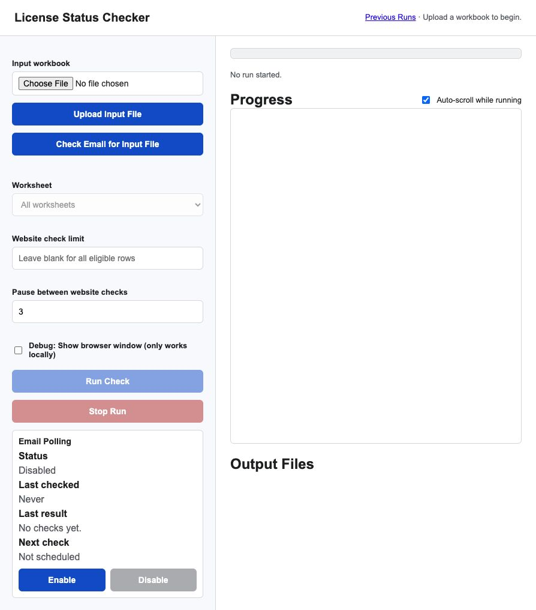

# License Status Checker

This is a TypeScript + Playwright rewrite of the Washington path from the old C# Selenium app.

## What It Does

The CLI reads an Excel workbook of Washington license holders, checks each license on Washington L&I, and writes:

- `Send.csv`
- `DoNotSend.csv`
- `Send-{date}.xlsx`
- `DoNotSend-{date}.xlsx`
- `coursesAlreadyTaken.xlsx`
- `expired.txt`
- `greaterThan90.txt`
- `exception.txt`

The bucketing rules match the old app:

- skip spreadsheet rows already expired
- skip spreadsheet rows more than 90 days out
- check the live L&I license page
- exclude invalid, non-active, or likely-renewed licenses
- map trade to CE hours:
  - `Plumber Trainee`: 8
  - `Plumber`: 16
  - `Electrician`: 24
- send active, near-expiration licenses with no completed CE credits
- do not send if any CE credits are already present

## Input And Output Files

By default, all input and output files live in a `Files` folder under the project root:

```text
license-status-checker/
  Files/
    ListToCheck.xlsx
    Send.csv
    DoNotSend.csv
    Send-{date}.xlsx
    DoNotSend-{date}.xlsx
    coursesAlreadyTaken.xlsx
    expired.txt
    greaterThan90.txt
    exception.txt
```

The input workbook must be named `ListToCheck.xlsx` unless you pass a custom `--input` path. The default input path is:

```text
Files/ListToCheck.xlsx
```

By default, the app reads only the supported worksheets in that workbook and ignores other tabs. To read only one supported worksheet, pass `--worksheet` with the sheet name:

```bash
npm start -- --worksheet Electricians
npm start -- --worksheet Plumbers
npm start -- --worksheet "Plumber Trainees"
```

Supported worksheet names:

- `Plumbers`
- `Plumber Trainees`
- `Electricians`

Each worksheet must use the Washington L&I export-style columns:

```text
License Type, License Number, Name, Address1, Address2, City, State, Zip, ExpirationDate
```

Spreadsheet rows are filtered before the app opens the Washington website:

- rows with missing license numbers or missing/invalid expiration dates are written to `exception.txt`
- rows with expiration dates in the past are written to `expired.txt`
- rows with expiration dates more than 90 days away are written to `greaterThan90.txt`
- only rows expiring today through 90 days from today are sent to the Washington website check

Generated output files are written to the output directory. By default, that is also `Files/`. You can change it with `--out-dir`.

- `Send.csv`: live pipe-delimited CSV output for send rows, appended during the website checks.
- `DoNotSend.csv`: live pipe-delimited CSV output for do-not-send rows, appended during the website checks.
- `Send-{date}.xlsx`: license holders who appear active, near renewal, and have no completed CE credits.
- `DoNotSend-{date}.xlsx`: license holders who should not be contacted, with a reason when available.
- `coursesAlreadyTaken.xlsx`: course title/code frequency report from licenses that already show completed CE credits.
- `expired.txt`: spreadsheet rows skipped before browser checks because the input expiration date is already past.
- `greaterThan90.txt`: spreadsheet rows skipped before browser checks because the input expiration date is more than 90 days away.
- `exception.txt`: spreadsheet parsing errors and Playwright/browser errors encountered during the run.

Example with explicit paths:

```bash
npm start -- --input ./Files/ListToCheck.xlsx --out-dir ./Files
```

## Setup

```bash
npm install
npm run install:browsers
```

## Run

Put the source workbook at:

```text
Files/ListToCheck.xlsx
```

Then run:

```bash
npm start
```

Useful options:

```bash
npm start -- --input /path/to/ListToCheck.xlsx --out-dir /path/to/Files
npm start -- --worksheet Electricians
npm start -- --worksheet "Plumber Trainees" --limit 5
npm start -- --headed
npm start -- --limit 10 --headed --slow-mo 100 --check-delay-ms 1000
```

`--headed` opens the browser visibly, which is helpful while validating selectors against the state website.

`--slow-mo` is a Playwright/browser debugging option. It slows down low-level browser actions such as navigation, locator operations, clicks, and typing. It is most useful with `--headed` when you want to watch what the browser is doing. It does not guarantee a clean pause between one license row and the next.

`--check-delay-ms` is the app-level Washington website throttle. It controls the pause between one license/person lookup and the next license/person lookup. This is the important setting for being gentle with the Washington website and reducing the chance of F5/HTTP `429` rate limits. It defaults to `1000`, which waits about 1 second between license rows.

## Web Interface

Start the local web interface:

```bash
npm run web
```

Then open:

```text
http://localhost:3000
```



The page lets you upload `ListToCheck.xlsx`, choose a worksheet, set an optional website check limit, set a pause between Washington website checks, and run the check. Progress is streamed to the page while the app loads the workbook, counts eligible rows, checks each license, and writes outputs. When the run finishes, the page shows view/download links for the output workbooks and logs.

The `Previous Runs` page lists run folders, shows summary counts from `run-state.json`, groups resumed runs with the original run, and lets you delete old runs. Deleting a run removes its folder under `Files/web-runs` and its output files from disk.

If Washington returns an HTTP `429` response, or appears to show an F5/rate-limit rejection page, the app writes that to `exception.txt` and stops the website checks before moving to the next license.

### Streaming And Resume Behavior

The web run pipeline is designed to be friendlier to cloud or small-VM hosting:

- spreadsheet rows are streamed from the input workbook instead of loading every row into memory at once
- `Send.csv` and `DoNotSend.csv` are written incrementally as each license result is bucketed
- final Excel workbooks are generated from the CSV files after the website checks finish
- run progress is persisted to `run-state.json` inside each run's output folder
- the UI progress feed is summarized so it does not emit every row to the browser

Each web upload or email-loaded workbook is stored under a timestamped run folder:

```text
Files/web-runs/{YYYY-MM-DD-HH-MM-SS}/
  ListToCheck.xlsx
  output/
    Send.csv
    DoNotSend.csv
    Send-{date}.xlsx
    DoNotSend-{date}.xlsx
    coursesAlreadyTaken.xlsx
    expired.txt
    greaterThan90.txt
    exception.txt
    run-state.json
```

`run-state.json` records the run phase, counts, output file paths, run options, and the most recent checked license checkpoint. This file is what the Previous Runs page uses to show summaries and decide whether a run can be resumed.

If a run is canceled, rate-limited, or fails after at least one license was checked, the Previous Runs page shows a `Resume` button. Resuming creates a new run folder, copies the original `ListToCheck.xlsx`, reuses the stored run options, streams the workbook again, skips eligible rows through the last checked license checkpoint, and continues with the next eligible row.

Resumed runs do not append into the original output files. They write their own output files in their own run folder. The Previous Runs page groups the original run and resumed runs together so the chain is visible.

For linked run groups, the Previous Runs page also provides combined export links for `Send.xlsx` and `DoNotSend.xlsx`. These combined files are generated on demand from the original run plus its resumed runs, in run order. The combined files are downloads only; they are not saved permanently into the run folders.

### Email Results

The web interface can email results after each run. Excel output files are attached to the email. Log files are included as links back to the local web server.

Create a local `.env` file next to `package.json`:

```text
SMTP_HOST=smtp.gmail.com
SMTP_PORT=587
SMTP_SECURE=false
SMTP_USER=your-email@gmail.com
SMTP_PASSWORD="your app password"
EMAIL_FROM=your-email@gmail.com
EMAIL_RECIPIENTS=recipient@example.com
```

Optional:

```text
EMAIL_BASE_URL=http://localhost:3000
```

If `EMAIL_BASE_URL` is omitted, the app uses the host from the web request, usually `http://localhost:3000`. Keep the web server running if recipients need to open the log links.

### Email Input Workbook

The web interface can also check email for an input workbook. Use the `Check Email for Input File` button for a manual check, or configure the scheduled poller to check once per day and automatically start a run when it finds a matching unread workbook.

Add IMAP settings to your local `.env`:

```text
IMAP_HOST=imap.gmail.com
IMAP_PORT=993
IMAP_SECURE=true
IMAP_USER=your-email@gmail.com
IMAP_PASSWORD="your app password"
INPUT_EMAIL_ATTACHMENT_NAME=WA Ele *.xlsx,WA PLM *.xlsx,WA PLM Trainees *.xlsx,Master List from Kelly for AnytimeCE Post card mailing *.xlsx
```

Optional filters:

```text
INPUT_EMAIL_FROM=tonynguyen3@gmail.com,techsupport1@anytimece.com,hvacschool@hvacschool.com,hvacshoolappemailer@gmail.com,hvacschoolappemailer@gmail.com
INPUT_EMAIL_SUBJECT_CONTAINS=License Status Input
```

The email checker looks at unread messages in newest-first order, finds the first message that matches the optional sender/subject filters, and loads the matching Excel attachment. `INPUT_EMAIL_FROM` accepts a comma-separated sender list. `INPUT_EMAIL_ATTACHMENT_NAME` accepts comma-separated wildcard patterns. Use `*.xlsx` if you want to allow any Excel attachment.

After a workbook is loaded from email, choose the worksheet/options and click `Run Check`. The email is marked read only after a matching workbook is loaded.

### Scheduled Email Polling

The web server can check email once per day at a configured local time. If it finds a matching unread workbook, it marks that message read, saves the workbook to a timestamped run folder, and starts the same run pipeline used by the web UI.

Add these optional settings to `.env`:

```text
EMAIL_POLL_TIME=06:00
EMAIL_POLL_WORKSHEET=Electricians
EMAIL_POLL_LIMIT=50
EMAIL_POLL_CHECK_DELAY_MS=1000
EMAIL_POLL_HEADED=false
```

`EMAIL_POLL_TIME` uses 24-hour `HH:MM` time in the server's local timezone. Setting `EMAIL_POLL_TIME` enables the scheduler at server startup; `EMAIL_POLL_ENABLED=true` can also be set explicitly. Leave `EMAIL_POLL_WORKSHEET` or `EMAIL_POLL_LIMIT` blank to run all worksheets or all eligible rows.

The web page shows the scheduler status, including the last checked time, last result, and next check time. The Email Polling panel also has a poll-time input plus Enable and Disable buttons for changing polling while the web server is running. When you click Enable, the page prompts for the daily poll time in 24-hour `HH:MM` format and schedules the poll using that time.

The UI buttons use the run settings already loaded from `.env`, including `EMAIL_POLL_WORKSHEET`, `EMAIL_POLL_LIMIT`, and `EMAIL_POLL_CHECK_DELAY_MS`. The poll time entered in the UI overrides `EMAIL_POLL_TIME` for the current server process only. These are runtime controls: disabling polling in the UI stops the pending timer, and enabling polling starts a new timer. `.env` still controls the default polling state and default poll time the next time the server starts.

`EMAIL_POLL_CHECK_DELAY_MS` has the same meaning as `--check-delay-ms`: it is the app-level pause between Washington license/person lookups during a scheduled run. It is not the same as `--slow-mo`, which is only for slowing down browser actions while debugging.

The app also writes scheduled email polling activity to:

```text
Files/email-poll.log
```

## Verify

```bash
npm run check
npm test
```

## Notes

The old C# app added records to an in-memory send list when the L&I page had no `Courses` section, but it did not write those rows to the Send spreadsheet. This rewrite appends every bucketed row to the live CSV files and then builds the Excel workbooks from those CSV files, so those send rows are preserved.

The Playwright selectors still depend on Washington L&I's page structure, especially:

- `#ExpirationDate`
- `#StatusDescription strong`
- `#LicenseType`
- `#Courses`
- `#coursesList .itemSingleCol`
