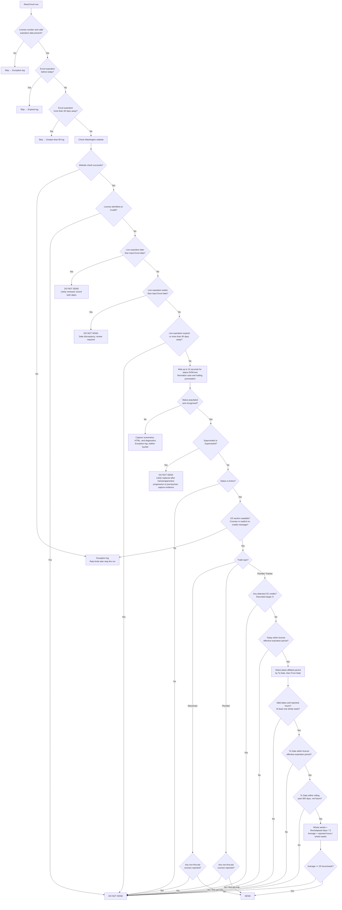

# Send Vs Do Not Send Decision Flow

[Back to README](../README.md#send-vs-do-not-send-business-logic)

This chart describes the supported trade rules. Skipped rows and website errors
go into logs, not either output bucket. A check limit or stopped run can leave
eligible rows unchecked.

For trainees, From Date determines reporting duration and may precede the
license effective date. Multiple employers reporting the exact same latest
From/To period have their reported hours added together. Hours approved are
not used. Any detected CE credits take precedence over affidavit activity.

CE targets are reporting values, not bucket thresholds. The first-aid exception
applies only to Plumbers and Electricians. Any title containing the whole-word
phrase First Aid matches, ignoring case and accepting whitespace or hyphens;
provider names and other title wording do not prevent a match. A separate course
without that phrase counts as other CE. Incomplete course data goes into the exception log.

Implementation details and limitations, including the CE parser and live
expiration handling, are described in the linked README section.

Non-active status is recorded verbatim in `LicenseStatus` and the exclusion
reason. Blank or unrecognized text is not evidence of inactivity. The reader
uses DOM text rather than rendered text so loading delays, collapsed sections,
or CSS formatting do not turn Active into a false Do Not Send decision.
Evidence is also captured when the initial status is blank but later resolves,
or rendered status differs from the final DOM text.
