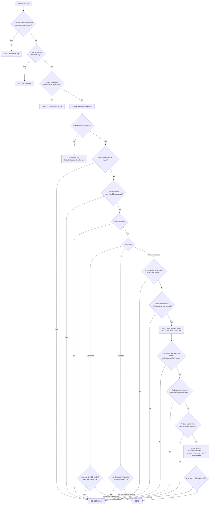

# Send Vs Do Not Send Decision Flow

[Back to README](../README.md#send-vs-do-not-send-business-logic)

This chart describes the supported trade rules. Skipped rows and website errors
go into logs, not either output bucket. A check limit or stopped run can leave
eligible rows unchecked.

For trainees, From Date determines reporting duration and may precede the
license effective date. Multiple employers reporting the exact same latest
From/To period have their reported hours added together. Hours approved are
not used. Any detected CE credits take precedence over affidavit activity.

The CE targets distinguish "some credits already" from "enough credits" in
Do Not Send; they do not allow people with partial credits into Send.

Implementation details and limitations, including the CE parser and live
expiration handling, are described in the linked README section.
